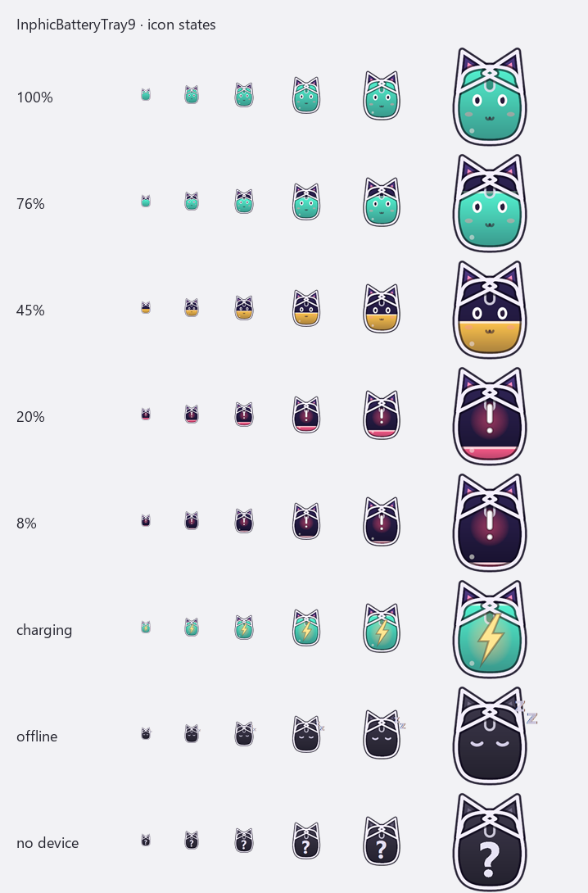

# InphicBatteryTray9

给 **英菲克 INPHIC IN9 / IN09** 无线鼠标做的任务栏电量小工具：常驻任务栏的小图标 + 点一下 2 秒的电量气泡 + 20% 无声音提醒。
其它品牌会尝试走「通用模式」读取标准 HID 电量（能不能用取决于鼠标本身）。


## 功能

- **任务栏小图标**：默认是自绘的猫耳能量瓶，底部一条电量条；也可以换成你自己的图片（见「自定义图标」）。
- **点击图标**：图标闪一下，旁边弹出 2 秒迷你电量气泡（百分比 + 电池液面动画），自动消失，不挡屏幕。
- **20% 静默提醒**：电量 ≤20% 时从任务栏上方滑出一张**完全不播放声音**的小卡片；回到 >25% 才重新上膛，持续低电量每 30 分钟最多一次。
- **每 5 分钟自动检测**（可改）；右键「立即刷新电量」可随时手动更新。
- **自定义名称**：右键「重命名鼠标…」，任务栏悬停和气泡都会用它。
- **右键菜单**：刷新 / 重新扫描 / 低电量提醒开关 / 预览提醒 / 重命名 / 自定义图标 / 开机自启 / 退出。
- 单实例、高 DPI、多尺寸图标、开机自启，纯单文件 EXE，不联网。

| 图标状态 | 20% 静默提醒 |
|---|---|
|  |  |

## 快速开始

1. 下载 Release 里的 `InphicBatteryTray9-便携版.zip`，解压到任意目录。
2. 双击 `安装.cmd`（会装到 `%LOCALAPPDATA%\InphicBatteryTray9\`、设置开机自启并启动）。
3. 如果 Windows 提示「Windows 已保护你的电脑」，点「更多信息 → 仍要运行」（程序未签名）。

也可以直接从源码编译（见文末），编译产物在 `dist\InphicBatteryTray9.exe`。

首次运行如果没看到图标，点任务栏右下角的 `^` 打开溢出菜单，把图标拖到任务栏上就会出现；右键菜单里的「固定到任务栏通知区」也能再试一次。

## 自定义图标

程序默认使用内置的猫耳能量瓶图标。想换成自己的形象（头像、表情包、OC 都行），有三种方式：

### 方式 1：右键菜单

右键任务栏图标 → **「选择自定义图标…」** → 选一张图片，程序会自动转成 PNG 保存并立即生效。

### 方式 2：直接放文件

把图片命名为 **`icon.png`**，放到下面任意一个位置（优先第一个）：

1. **程序所在目录**（便携版就放在 exe 旁边）
2. `%LOCALAPPDATA%\InphicBatteryTray9\icon.png`

右键菜单 →「打开图标文件夹」可以直接打开第 2 个目录。放好后重启程序即可。

### 方式 3：命令行

```bat
InphicBatteryTray9.exe --icon=D:\my-icon.png
```

### 图片建议

- **正方形**，建议 **≥192×192**，越大越清晰；
- **透明底 PNG** 效果最好（白底会带上一个白方块）；
- 主体尽量**居中**，程序会自动按中心裁成正方形；
- 任务栏实际只有 24px 左右，细节太多的小图会糊，简单大头/大色块最清楚；
- 换完后图标下方仍会显示电量条和状态角标（充电⚡ / 低电量❗ / 休眠 z / 未连接 ?）；
- 想恢复默认：删掉 `icon.png`，重启程序。

> 本仓库**不内置任何第三方角色形象**，默认图标是程序自绘的猫耳能量瓶；你换的图片只存在你自己的电脑上。

## 自定义名称 / 检测间隔

- 名称：右键「重命名鼠标…」，或在命令行用 `--name=我的鼠标`；
- 间隔：默认 5 分钟，可在 `%LOCALAPPDATA%\InphicBatteryTray9\settings.ini` 里改：

```ini
name=我的鼠标
interval=300000    ; 毫秒。想 5 秒刷新一次就写 5000
```

设置文件也会被「重命名」菜单自动更新。

## 命令行参数

| 参数 | 说明 |
|---|---|
| `--list` | 列出所有 HID 接口 |
| `--test` | 对 IN9 发 3 次查询，打印原始帧与解析结果 |
| `--find-battery` | 通用模式诊断：扫描鼠标，尝试读取标准 HID 电量 |
| `--probe` / `--probe-all` | 探测厂商通道 |
| `--vids=248A,249A` | 覆盖 VID 列表 |
| `--pids=XXXX` | 限定 PID |
| `--mi=02` | 强制接口号 |
| `--interval=300000` | 查询间隔 ms（默认 5 分钟） |
| `--offline=615000` | 离线判定 ms（默认按间隔自动算） |
| `--low=20` | 低电量阈值 |
| `--low-release=25` | 解除阈值 |
| `--low-mins=30` | 持续低电量的提醒冷却（分钟） |
| `--name=名字` | 自定义显示名称（会保存） |
| `--rename` | 打开重命名对话框 |
| `--icon=图片路径` | 设置自定义图标（复制到图标目录） |
| `--no-low-notify` | 关闭低电量提醒 |
| `--no-anim` | 关闭图标动画 |
| `--notify-test` | 立刻弹一次静默提醒 |
| `--icons-out=目录` | 导出全部图标 PNG / `.ico` / 气泡与提醒预览 |
| `--preview=秒` | 直接预览气泡与提醒 |
| `--log=路径` | 写日志 |

## 工作原理

**IN9 / IN09**（VID `248A`，PID `5B2E` / `5B2F`）：

- 通道：HID **Feature Report**，报告 ID `0x0C`，长度 33 字节；
- 握手：`0C 01 F0 00 <seq> 01 01 FF`（只发不收）；
- 查询：`0C 01 20 00 <seq> 00 00`，写完后 `HidD_GetFeature` 读回；
- 解析：`buf[2]==0x20`、`buf[6]!=0` 有效，`buf[0x12]`=电量%，`buf[0x13]`=状态，`buf[0x15]`=在线；
- 充电时协议把状态置 2，原厂软件会强制显示 100%，本工具沿用官方行为。

电量是鼠标**自己上报的百分比**（1% 精度），没有电压估算，也不需要校准。

**其它品牌**：走通用模式，扫描标准 HID 电量字段（Battery Strength / Relative State of Charge 等）。
很多鼠标把电量放在厂商私有协议里（例如雷蛇的私有命令），通用模式读不到；先用 `--find-battery` 看看能不能打印出电量。

## 编译

只需要 Windows 自带的 .NET Framework 4.x 编译器，**不用装 SDK**：

```bat
编译.cmd
```

或：

```powershell
powershell -ExecutionPolicy Bypass -File build.ps1
```

手动：

```bat
C:\Windows\Microsoft.NET\Framework64\v4.0.30319\csc.exe /target:winexe /platform:x64 /codepage:65001 ^
  /win32manifest:app.manifest ^
  /out:dist\InphicBatteryTray9.exe ^
  /reference:System.dll /reference:System.Windows.Forms.dll /reference:System.Drawing.dll /reference:System.Core.dll ^
  src\*.cs
```

> `app.manifest` 里的 `dpiAware` 必须保留，否则 150% 缩放下图标和气泡位置会偏。

## 隐私与安全

- 只发送官方软件同款的**读取**命令，不修改鼠标任何设置；
- 不联网、无遥测、单文件 EXE；
- 低电量提醒是本地自绘卡片，不播放声音、不弹系统通知；
- 自定义图标只保存在本机。

## 已知限制

1. IN9 / IN09 完整支持；其它品牌走通用模式，很多私有协议读不到，先用 `--find-battery` 确认。
2. 需要 Windows 10/11 + .NET Framework 4.x + 64 位。
3. 托盘图标的显示/固定由资源管理器决定，Win11 新图标默认在 `^` 溢出区，拖出来一次即可。
4. 电量精度 1%，默认 5 分钟查询一次；休眠/关机只能靠超时判断。
5. 多只鼠标同时插入时只显示最近活跃的一只。
6. 系统级 DPI 感知：多显示器不同缩放时，副屏上的气泡可能略糊。

## 致谢

- [MRXie-zf/InphicBatteryTray-IN9](https://github.com/MRXie-zf/InphicBatteryTray-IN9) — IN9 协议与诊断实现（本项目基础）
- [Tan-TanZi/InphicBatteryTray](https://github.com/Tan-TanZi/InphicBatteryTray) — IN10 版托盘
- [RuiShu1024/InphicMouse](https://github.com/RuiShu1024/InphicMouse) — IN9 协议逆向参考

MIT License。非官方第三方工具，与英菲克（INPHIC）无关。
